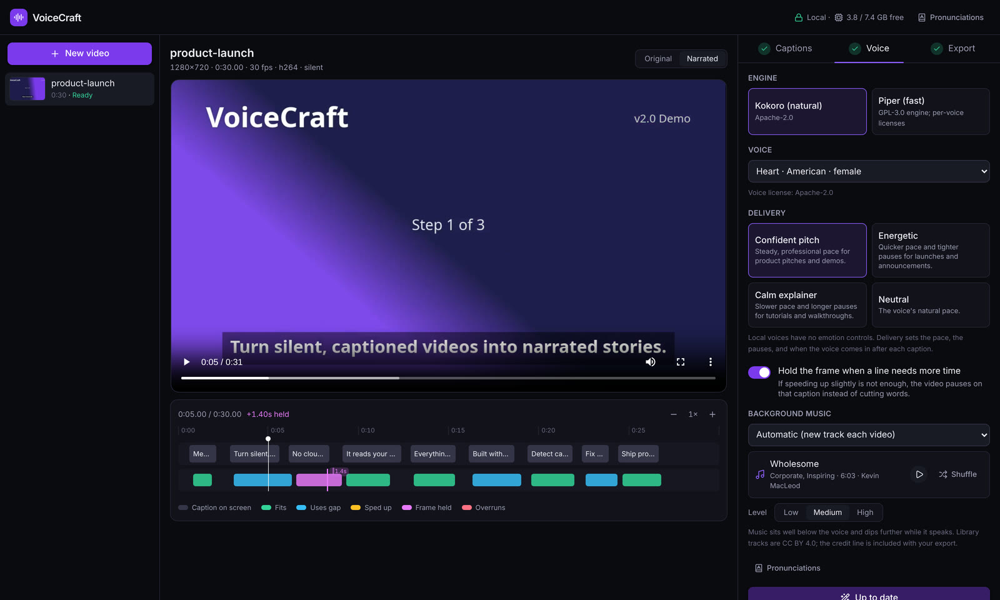
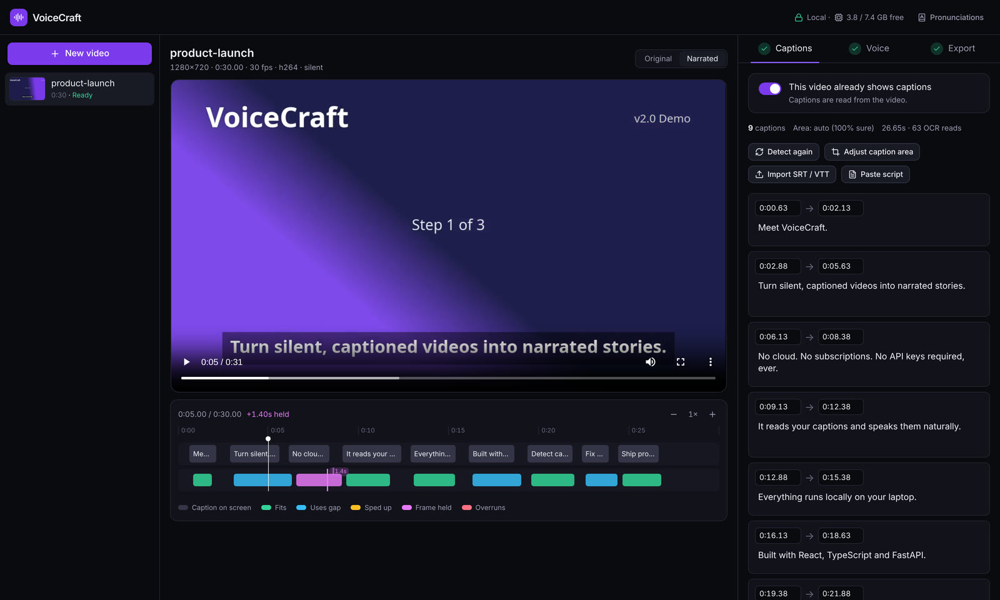
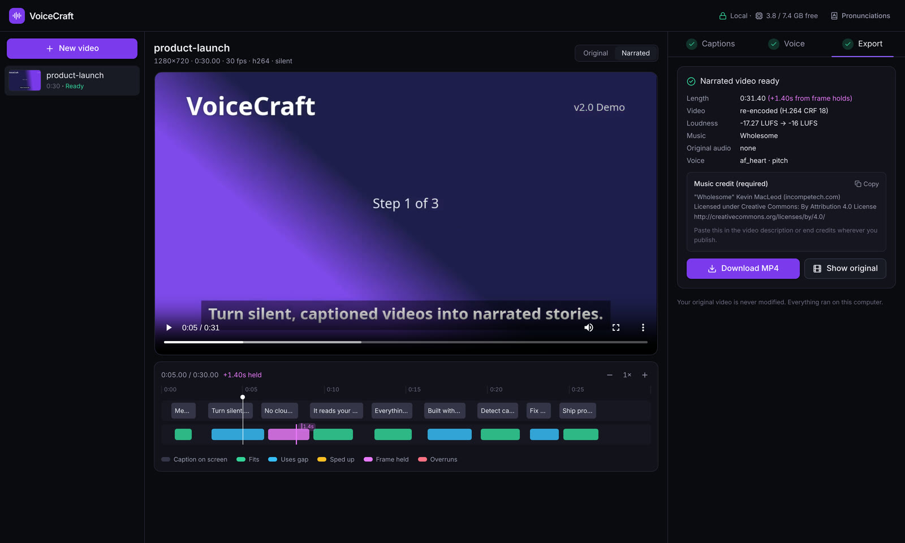

<div align="center">



<br/>


**Turn a silent, captioned video into a narrated one: natural voice, timed to every caption, with background music.**
**It all runs on your own computer: no cloud, no subscriptions, no API keys.**

[Demo](#demo) · [The problem](#problem) · [The solution](#solution) · [How it works](#how-it-works) · [Install](#install) · [Use](#use)

</div>

---

---

<a id="problem"></a>

## 😶 The problem

AI tools such as **Claude Code** and **Claude Design** can now produce polished product videos in minutes: pitch videos, feature walkthroughs, launch teasers, explainers. They look great, but **most come out silent**: just animations and captions on screen.

A silent video feels unfinished, and giving it a voice is surprisingly hard:

| | |
|---|---|
| ⏱️ **Slow** | Recording, editing and retiming narration takes hours, and every script change means recording again. |
| 💸 **Expensive** | Studio gear, voice actors, or per-minute cloud text-to-speech subscriptions. |
| 🎚️ **Fiddly** | Lining each sentence up with its caption, ducking the music, and getting the loudness right are all manual work. |
| 🔒 **Not private** | Cloud voice tools mean uploading unreleased product videos to someone else's servers. |

<a id="solution"></a>

## 💡 The solution

**VoiceCraft** takes the silent video and does the rest automatically, locally and for free.

<table>
<tr>
<td width="33%" valign="top">

### 👀 Reads your captions
Finds the captions already burned into the video, even in several places at once (headlines at the top, callouts at the bottom). It ignores logos, UI text and screen recordings. No subtitle file needed.

</td>
<td width="33%" valign="top">

### 🗣️ Speaks naturally
Narrates every line with **Kokoro**, a high-quality open voice model. It knows how to say product names, version numbers, prices and acronyms. Pick from 13 voices and 4 delivery styles.

</td>
<td width="33%" valign="top">

### ⏱️ Syncs to the captions
Each line starts as its caption appears. Lines that run long borrow the gap, get slightly faster, or freeze the frame briefly, and **words are never cut**.

</td>
</tr>
<tr>
<td valign="top">

### 🎵 Adds music
A different royalty-free track for every video, matched to the mood. It sits under the voice and dips while the voice speaks.

</td>
<td valign="top">

### 🎚️ Mixes like a studio
EBU R128 loudness at **−16 LUFS**, a −1.5 dBTP peak ceiling, EQ carved for speech. The video stream is copied untouched whenever possible.

</td>
<td valign="top">

### 🔒 100% local
Runs on a normal laptop CPU with about 0.8 GB of RAM. After a one-time model download it works fully offline.

</td>
</tr>
</table>

**No captions on screen?** Upload a subtitle file (`.srt`, `.vtt`, `.json`) or a plain-text script with the video. A script is spread across the video according to how long each line takes to say.

<a id="how-it-works"></a>

## ⚙️ How it works

<div align="center">

</div>

1. **Find the caption bands.** VoiceCraft samples a few frames and keeps text that is *large* and *keeps changing*. Static logos, small UI text and walls of screen-recording text are rejected.
2. **Read only when something changes.** Frames are sampled 4 times a second, and OCR runs only when the caption area actually changes, about 1 frame in 3. Typewriter and word-by-word reveals are merged into one caption.
3. **Clean up the words for speech.** `v2.0` → "version 2 point 0", `$5M` → "5 million dollars", `10x` → "10 times". A pronunciation list you can edit handles brand names.
4. **Speak and place each line.** Each line is spoken with Kokoro, measured, and placed 0.2 s after its caption appears. Clips are cached, so editing one caption re-voices only that line.
5. **Resolve lines that are too long.** They borrow the following gap, then start the next line up to 0.8 s late, then speed up at most 1.12× using the voice model itself, and only then freeze the frame. Nothing is ever time-stretched or cut off.
6. **Mix and export.** Voice + music (+ the original audio, if any) are ducked, normalized to −16 LUFS, and written to an MP4. The original video file is never modified.

## 📸 Screenshots

<div align="center">

<br/><sub><b>Voice, delivery and background music:</b> the timeline shows every caption (top lane) and its narration (bottom lane), colour-coded by how it fits.</sub>
<br/><br/>
&nbsp;&nbsp;
<br/><sub><b>Left:</b> fix any caption's text or timing. <b>Right:</b> export with loudness, music and the required music credit.</sub>
</div>

<a id="install"></a>

## 🚀 Install

**Requirements:** Linux (built on CachyOS), any recent 4-core CPU, 8 GB RAM, no GPU.
You also need [`ffmpeg`](https://ffmpeg.org), [`uv`](https://docs.astral.sh/uv/) (it installs Python 3.12 for you), and Node 20+ with `pnpm` to build the web UI.

```sh
git clone https://github.com/Taha493/VoiceCraft.git && cd VoiceCraft

# 1. Backend: Python 3.12 environment (~730 MB, CPU-only, no PyTorch)
cd backend
uv sync
uv run voicecraft setup     # one-time download: voice model, voices, music library
uv run voicecraft doctor    # checks ffmpeg, models and RAM

# 2. Web UI (built once; the backend serves it)
cd ../frontend
pnpm install && pnpm build
```

<details>
<summary><b>Optional extras</b></summary>

```sh
# Piper: a much faster but flatter voice engine (GPL-3.0)
uv sync --extra piper && uv run voicecraft setup --piper

# Tesseract as an alternative OCR engine
sudo pacman -S tesseract tesseract-data-eng && uv sync --extra tesseract
```

</details>

<a id="use"></a>

## 🎛️ Use

### Web app

```sh
cd backend && uv run voicecraft serve --open      # http://127.0.0.1:8765 (local only)
```

1. **Drop in a video** and say whether it **already shows captions**.
   - **Yes:** VoiceCraft reads them. If none need review, the voice-over is generated automatically.
   - **No:** attach a subtitle file or a `.txt` script.
2. **Check the captions** if you like. You can edit text and timing, redraw the caption area, import an SRT, or paste the exact script.
3. **Choose a voice, a delivery style and music** (automatic, a specific track, or none). Use **Shuffle** for a different track.
4. **Preview and download** the MP4. The music credit line is ready to copy.

### Command line

```sh
uv run voicecraft run video.mp4                                     # → video.narrated.mp4
uv run voicecraft run video.mp4 --voice am_michael --preset energetic
uv run voicecraft run video.mp4 --captions subs.srt                 # skip OCR
uv run voicecraft run screen.mp4 --no-ocr --script script.txt       # video without captions on screen
uv run voicecraft run video.mp4 --music none                        # or: --music chill-wave --music-level low
uv run voicecraft voices                                            # list voices and their licenses
uv run voicecraft music                                             # list music tracks
```

<details>
<summary><b>Background music details</b></summary>

- **Library:** 14 instrumental tracks by Kevin MacLeod (incompetech.com), licensed CC BY 4.0. That means free use, commercial included, as long as you credit the track; VoiceCraft generates the credit for you.
- **Moods:** each delivery style has 6 matching tracks (corporate/inspiring, upbeat, calm). Recent picks are skipped, so consecutive videos don't repeat.
- **Selection:** tracks were chosen by measurement: steady loudness, no silent gaps, long enough not to loop.
- **Your own music:** drop audio files into `~/.local/share/voicecraft/music/`; they join every mood.
- **Existing audio:** videos that already have sound get no extra music by default.

</details>

<details>
<summary><b>Pronunciations</b></summary>

Use the **Pronunciations** dialog in the app, or edit `~/.local/share/voicecraft/lexicon.json`:

```json
{ "Supabase": "Soopa base", "Vite": "veet" }
```

Write acronyms in capitals (`API`, `UI`), and the voice spells them out naturally.

</details>

## 📊 Measured performance

On an Intel i5-1035G1 laptop (4 cores, 15 W) with 8 GB of RAM:

| | |
|---|---|
| Speech speed | **0.70× real time** (Kokoro, 4 CPU threads) |
| Peak memory | **~0.7 GB**: each step runs in its own process and frees its memory when done |
| Caption accuracy | **100 %** of captions found, **0 %** character errors, timing within ±0.17 s (synthetic test videos and a real 40 s showcase video) |
| End to end | about **2–3.5× the video's length**, depending on load. A 60 s 1080p video took 98–170 s |
| Output | −16 LUFS integrated loudness, true peak ≤ −1.5 dBTP |
| Offline | the full pipeline passes with networking disabled |

Full numbers, methodology and known limitations are in **[docs/BENCHMARKS.md](docs/BENCHMARKS.md)**.

## 🧱 Tech stack

| Layer | Technology |
|---|---|
| Voice | [Kokoro-82M](https://github.com/hexgrad/kokoro) on ONNX Runtime, [misaki](https://github.com/hexgrad/misaki) pronunciation, optional [Piper](https://github.com/OHF-Voice/piper1-gpl) |
| Caption reading | [RapidOCR](https://github.com/RapidAI/RapidOCR) (PP-OCR models on ONNX), OpenCV, optional Tesseract |
| Media | FFmpeg: streamed decoding, sidechain ducking, EBU R128 loudness, H.264 |
| Backend | Python 3.12, FastAPI, Pydantic, uv |
| Frontend | React 19, TypeScript, Tailwind CSS 4, Vite |

## 🗂️ Project structure

```
backend/src/voicecraft/
  captions/   caption-band detection, change-gated OCR, tracker, SRT/VTT/script import
  text/       speech normalizer + editable pronunciation lexicon
  tts/        common engine interface: Kokoro (ONNX + misaki), Piper
  sync/       delivery presets, cached synthesis, narration planner (overrun ladder)
  media/      ffprobe, streamed frame decoding, mixing and final render
  music.py    music library, mood matching, no-repeat selection
  jobs/       on-disk job state, per-stage child processes, single-worker queue
  api/        FastAPI app (also serves the built UI)
backend/tests/       unit, API and end-to-end tests (VOICECRAFT_E2E=1 for the slow ones)
backend/bench/       TTS benchmark, synthetic test videos, pipeline benchmark
frontend/            React + TypeScript + Tailwind UI
docs/                benchmarks and README assets
```

## ⚠️ Limitations

- **Caption sync, not lip sync.** VoiceCraft narrates over the video; it doesn't animate faces.
- **No acted emotion.** Local voices have no emotion controls. Delivery styles change pace, pauses and timing.
- **English only** for now.
- **Captions inside a screen recording are skipped.** Text that sits inside a recorded window is treated as screen content. Add any missed line with *Add caption*.

## 📜 Licenses of downloaded components

| Component | License |
|---|---|
| Kokoro-82M weights and voices | Apache-2.0 |
| kokoro-onnx / misaki | MIT / Apache-2.0 |
| espeak-ng (fallback pronunciation, via `espeakng-loader`) | GPL-3.0 |
| RapidOCR / PP-OCR models | Apache-2.0 |
| Piper engine (optional) | GPL-3.0 |
| Piper voices offered: `joe` | CC0 |
| Piper voices offered: `libritts_r` | CC BY 4.0 |
| Background music (Kevin MacLeod, incompetech.com) | CC BY 4.0, credit required (generated automatically) |

<div align="center">
<br/>

**Built by Taha Mahmood**

<sub>If VoiceCraft gave your video a voice, a ⭐ helps others find it.</sub>

</div>
